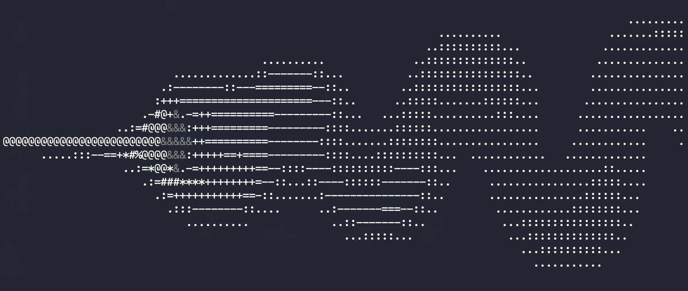

# ./smokessh

>[!TIP]
>Have IPv6? Try it out at ```ssh -p 2222 smokessh.awokolaw.com```

<p align="center">
    
</p>

Terminal smoke simulator made in C, wrapped around a Go ssh server.
Move an object around various scenarios and switch up settings to your liking.

## Usage
>[!NOTE]
> These flags apply to the executable itself, and not to the ssh server.

```./smokessh [-cdefhostw]```
- -c "number" → sets the cell size to number
- -d "path" → searches for presets in path instead of ./
- -e "file" → loads file as default emitter file
- -f "number" → sets the target fps to number
- -h → shows usage information
- -o "number" → sets the obstacle radius to number
- -s "number" → sets the timestep to number
- -t "number" → sets the ambient temperature to number
- -w "number" → sets the wind to number

Example:
```
./smokessh -f120 -d"../presets/" -t300
```
Sets target fps to 120, presets folder to ../presets/, and ambient temperature to 300.

> [!IMPORTANT]
> There must be a "default" properly defined emitter file either in the same directory of 
> the executable or in the -d flag defined folder.

## Emitter files

Two main unit types;
 - percent: percentage of screen; 50 50 with a terminal of size 120 x 60 would be cell 60,30
 - cells: absolute coordinates

```
units percent/cells
emitter x y r g b temp
...
emitter x y r g b temp
```

Example:

```
units percent
emitter 50 50 10 10 10 277
```
> [!IMPORTANT]
> Smoke might appear stuck when using units percent due to the percentage causing the smoke
> to spawn on the solid walls of the simulation. Use higher percentage, or switch to units

## Building

smokessh has two parts: the simulation (C, built with CMake)
and an SSH server wrapper (Go, 'in wrapper/').

### Requirements

- A C Compiler (GCC or Clang) with C11 support
- CMake 3.12 or newer
- Go 1.27.3+
- A POSIX system (Simulation uses terminal/PTY features).

### 1. Build the simulation

From the repository root:
```
cmake -S . -B build -DCMAKE_BUILD_TYPE=Release
cmake --build build
```
This produces 'build/smokessh'.

You can run the simulation directly in your terminal at this point:

```
./build/smokessh -d"../presets"
```

### 2. Build the SSH wrapper

```
cd wrapper
go mod download
go build -o smokessh-server .
```

This produces `wrapper/smokessh-server`.

### 3. Run the SSH server

The wrapper launches the C executable for each SSH session, so it must be able to
find it. Run it from a directory containing the C binary and your presets.

The SSH server accepts a few flags:

- -ip "4" or "6" sets IPv4 or IPv6
- -presets "path/to/presets/dir" sets the presets directory location
- -exe "path/to/executable" sets the smokessh executable location

Connect through

```ssh -p 2222 localhost```